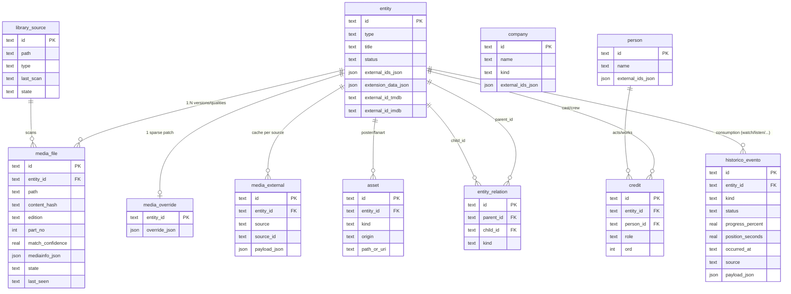

# 04 — Data model

This is the project's central document. It defines **how the data is modeled** in
order to support, at the same time: the owner's authority (override), the catalog
that is larger than the library (`status`), and universality (one entity for any
media, extensible without touching the core).

## Model principles

1. **Entity-first.** Every media item is a generic **`Entity`** with a minimum,
   standardized set of fields. "Movie" and "series" are entity *types*, not
   different schemas.
2. **Isolated extension.** Fields specific to a vertical live in
   **`extension_data`**, a *namespaced* JSON blob — never in new core columns.
   Adding a vertical does not change the central schema.
3. **Layered composition.** The final value of any field is resolved as
   `user override ⟵ external data ⟵ file data`. The truth that is served is the
   composed one, not the raw one.
4. **Non-destructive.** Neither an external-source re-scrape nor the removal of an
   extension erases the owner's data automatically. Purging is always explicit.
5. **SQLite-native.** The model is designed for SQLite (JSON1 + FTS5 + generated
   columns), not for Postgres JSONB/GIN.

## The base entity

Core fields (common to any media):

| Field | Type | Note |
|---|---|---|
| `id` | uuid/text | Stable internal identity |
| `type` | text | `movie`, `tv`, `season`, `episode`, `collection`, … (extensible) |
| `title` | text | Canonical title (after override) |
| `original_title` | text? | |
| `description` | text? | Synopsis/plot |
| `release_date` | date? | ISO `YYYY-MM-DD` |
| `status` | text | Owner **intent** (`cataloged` default / `wanted` / `unreleased` / `draft`) — see below. Ownership is **not** status |
| `tags` | json[] | Free list |
| `external_ids` | json | `{ "tmdb": "123", "imdb": "tt..." , … }` — **authoritative identity map** (see [External identity](#external-identity-external_ids-authoritative-vs-media_external-cache)) |
| `extension_data` | json | Per-vertical data, *namespaced* — see below |
| `created_at` / `updated_at` | timestamp | |

Relationships and auxiliary items (people, companies, assets, files, relations
between entities) are **tables of their own**, not loose fields — see
[Persistence](#persistence-sqlite).

### Ownership and `status`: two orthogonal axes

*"Do I have the file?"* and *"what do I intend for the item?"* are **independent**
questions. Modeling them on separate axes is what sustains the "database larger than
the library" ([scenario D](01-vision-and-use-cases.md)):

- **Ownership — derived fact.** It is not an editable field: it is computed from the
  existence of at least one `media_file` for the entity (*"in the library"* vs
  *"catalog only"*). Because it is derived, it neither lies nor diverges from the
  disk. It may be materialized as a generated column for fast filtering.
- **`status` — owner intent.** One state at a time:
  - `cataloged` — normal, curated item (**default**).
  - `wanted` — desired / wishlist.
  - `unreleased` — cataloged, not released yet.
  - `draft` — draft / under curation.

The axes combine freely:

| `status` | ownership | Meaning |
|---|---|---|
| `cataloged` | yes | the ordinary shelf item |
| `wanted` | no | pure wishlist |
| `wanted` | yes | I have a copy, but I want an upgrade (cam rip → Blu-ray) |
| `unreleased` | no | cataloged, still to be released |

> **There is no `owned` column.** The old `owned` value was ownership disguised as
> intent — now ownership is derived and `status` is intent only. The **transitions**
> of `status` when a file shows up/disappears stay in the
> [00 — decision agenda, MD5](00-decision-agenda.md).

## The resolver (layered composition)

The resolver composes the final value of each entity from three layers, in the
precedence order below. It is a **generic engine**: it knows no field by name —
neither core nor extension. It is guided by metadata (see
"Origin per field").

```
        ┌─ media_override   (the owner edited it → always wins)
value ──┼─ media_external   (pulled from the external source(s) → editorial base)
        └─ media_file       (extracted from the file: mediainfo → technical facts)
```

- **File** (`media_file.mediainfo`): detected technical facts (codec, HDR,
  tracks, real duration). It is what the file *is* — but it **can be corrected by
  override** (the originally detected value remains preserved; see "Override over the
  technical").
- **External** (`media_external`): payload pulled from each source, stored **raw and
  identified by source**, for re-composing or re-pulling. It is the editorial base.
- **Override** (`media_override`): the owner's **sparse** patch — only the fields
  they changed. It is what gives them final authority. **Override is universal**: it
  reaches any field, without exception (including technical and extension fields).

Re-enriching updates only `media_external`; `media_override` remains
untouched. That is what satisfies A3/B3/G2.

### Origin per field (partitioning)

The three layers do **not** compete indiscriminately for every field: each field
declares from which **base sources** it may come (`arquivo`, `externo`, or `nenhuma` —
the last one for items that exist only if the owner creates them, such as the
"homemade" series of [scenario C](01-vision-and-use-cases.md)). **The override is not
declared** — being universal, it applies to all of them.

That declaration is **field metadata**, not a fixed table in the code:

- **Core fields** declare their origin in the core schema (a small and stable set).
- **Extension fields** declare their origin as an annotation in the **JSON Schema of
  the namespace itself** (see `extension_data`). Adding a vertical/plugin touches
  neither the core nor the resolver.

Thus, `title`/`description` have base `externo`; `video_codec`/`hdr` have base
`arquivo`; a `season_number` of `core.tv@1` declares its own base in the vertical's
schema. The resolver merely reads the label and composes.

**System** fields (`id`, `created_at`, `updated_at`, `content_hash`) stay
**outside** the resolver: they are identity/audit, not editorial value.

### Priority between external sources

When more than one external source (multi-provider view) has a value for the same
field, the resolver uses a **global, configurable priority list** of sources
(e.g.: `[tmdb, tvdb, musicbrainz]`). For each field, the first source in the list that
has a value wins; the result forms the external base, on top of which the override
comes in. **MVP default:** `[tmdb]`. (Per-field priority or a primary source per
entity remain post-MVP evolution, without breaking the model.)

### List fields: merge by operations

Fields that are **lists of simple values** (`tags`, `genres`) are not replaced as a
block by the override: it stores **additions** and **removals by value**, and the
external base remains alive underneath (a re-scrape that brings a new genre includes
it, without undoing the owner's edits). The displayed order follows the external one,
with removals applied and additions at the end; duplicate items are deduplicated
during composition.

> **Relation lists** (cast, crew) are **not** list fields of this kind:
> they live in their own tables (`person`/`credit`) and their override is handled in
> the next section.

### Relation override (cast/crew)

Cast and crew are **relations** (`person`/`credit`), not simple values — but they
follow the **same philosophy as R3**: merge by operations, with the external base
alive underneath (re-scrape evolves the rest). The override stores **operations on
credits**:

- **add** — includes a new credit (e.g.: a local actor that the provider did not
  bring). The person becomes a `person`; if they have no external id, they are born
  **local** (`external_ids` empty — allowed, see
  [External identity](#external-identity-external_ids-authoritative-vs-media_external-cache)).
- **remove** — drops a wrong credit.
- **edit** — fixes role/character or `ord` (billing order).

The displayed order follows the external one, with the operations applied; dedup by key.

**Credit key:** `person_id` + **role/department** (cast/crew + job). This
distinguishes the same person in two roles (director **and** writer = two credits,
two keys). When the provider supplies a `credit_id`, it serves as a **tiebreaker**.

Physically, the `credit` rows reflect the external base; the owner's operations live in
`media_override` (R4) and the resolver composes **credit by credit** — just like any
other field (R5).

### Uniform composition (core and extension)

The resolver **does not distinguish** a core field from an `extension_data` field: the
same precedence `override ⟵ external ⟵ file` holds field by field, **including inside
the extension namespaces**. The override patch mirrors the whole entity,
extension included.

### "No override" vs. "override to empty"

Since the override is a sparse patch, the **presence of the key** is the authority
signal:

- **Key present** in the patch (even with a `null`/empty value) → the owner decided;
  it beats the external base, **including to erase** a value that the source insists on
  bringing.
- **Key absent** → there was no override; the value is inherited from the base.

The edit UI must distinguish **"clear override"** (remove the key, going back to
inheriting) from **"set empty"** (key present with `null`). **Per-field provenance**
(which layer the value came from) **is not exposed in the API** for now — the UI
queries the override separately when it needs to.

### Override over the technical

Because the override is universal, the owner can **correct a misdetected technical
fact** (e.g.: an `ffprobe` false-positive HDR) through the same mechanism. The
originally detected data remains in `media_file` (non-destructive); the override merely
sits on top during composition. It is an exception use, not routine use.

## The execution queue

`queue_item` is the single source of truth for every scan and every job
([ADR-0028](adr/0028-unified-execution-queue-scan-and-jobs.md)), one row per run:

| Column | Meaning |
|---|---|
| `kind`, `ref_id` | `scan` (a `library_source.id`) or `job` (a `job_definition.id`) |
| `trigger` | `manual`, `schedule` or `watch` |
| `status` | linear lifecycle: `queued → running → success \| error` |
| `progress_current/total` | items seen of items known, for the current step |
| `step_index/step_total/step_label` | where in the run's pipeline it is (`0/0` = no steps) |
| `current_item` | what is being processed right now (path, title, source) |
| `progress_ok/progress_failed` | items that succeeded/failed in this run |
| `message` | the **final** result only (a live narration goes to `step_label`/`current_item`) |
| `enqueued_at`, `started_at`, `finished_at` | the three stamps every duration is derived from |

`queue_item_event` is the **bounded trail** behind "which items failed": one row per item a
runner finished (`status` ∈ `ok, error, skip`, a free-text `label`, an optional `detail`),
`seq` ordered per item and capped at 200 rows per run, pruned at write time
([ADR-0040](adr/0040-queue-observability.md)). It shares the lifecycle of its parent
(`ON DELETE CASCADE`) and never outlives the retained history.

Durations are **not** columns: `wait_ms`, `elapsed_ms` and `duration_ms` are derived from the
three stamps, so a stored value can never disagree with them.

## `extension_data` — per-vertical extension

Fields that are not universal (e.g.: an episode's `season_number`; in the future a
game's `platform`, a book's `isbn`) live under a **namespaced key**:

```json
{
  "extension_data": {
    "core.tv@1": { "season_number": 2, "episode_number": 5 },
    "core.movie@1": { "collection_ref": "col-uuid" }
  }
}
```

Rules:

- **Mandatory namespace**: `<owner>.<slug>@<major>` (e.g.: `core.tv@1`). In the MVP,
  the verticals are **internal** (`core.*`); in the future, plugins use their own
  namespace (`plugin.games@1`).
- **Validated schema**: each vertical registers a JSON Schema; the core **validates the
  blob before persisting** and rejects whatever does not conform.
- **Non-destructive**: disabling/removing a vertical **does not erase** the blob;
  purging is an explicit admin action.
- **Binary outside the JSON**: heavy files (artwork, PDFs) **never** enter the
  blob — they go to disk/asset and the JSON holds only a reference.

> **Why this, and not per-type columns:** it allows cataloging any media on the
> server ([scenario I](01-vision-and-use-cases.md)) without a schema migration for
> every new vertical, and it is the foundation that future plugins rest on —
> without paying the cost of the plugin machinery now.

## Lifecycle and deletion

The **non-destructive** principle governs what happens when a file disappears. Central
rule: **file events touch only ownership (derived); never `status` (intent) nor the
owner's work.**

- **File disappears.** The `media_file` becomes `missing` on scan (see
  [06](06-library-and-scan.md)); the **entity is preserved**. Since ownership derives
  from having a **present** `media_file`, it becomes *not owned* — but the `status`
  stays **intact** (a `cataloged` item without a file remains `cataloged`; the owner
  decides whether they now "want" it back).
- **File appears** for a `wanted` item → ownership=yes and the `status` **stays**
  `wanted` (preserves "I have a copy, I want an upgrade"). The system never rewrites
  intent.
- **Datasource offline** (unmounted HD) marks nothing as `missing` — the absent disk
  is not a deletion (see [06](06-library-and-scan.md)).
- **Orphans.** An **auto-created** entity whose file disappeared and that has **no
  investment from the owner** — no `media_override`, no custom asset, no manual
  collection, `status` still at the default `cataloged` — is marked **orphan** and goes
  to a cleanup queue. **It is never deleted on its own.**
- **Purge** is the only destructive operation, and it is always **explicit** from the
  owner (individual or in batch): it removes the entity and its derivatives
  (`media_external`, `media_override`, assets). A `media_file` for a file that **still
  exists** on disk is never purged by the system.

### Core schema (Phase 2 — settled)

The tables below are already **real schema** (migration `0002_schema_nucleo.sql`), no
longer a sketch. `*_json` are `TEXT` with JSON validated by the app before writing.

```
entity            (id, type, title, original_title, description,
                   release_date, status, tags_json, external_ids_json,
                   extension_data_json, created_at, updated_at,
                   external_id_tmdb, external_id_imdb)
                   -- status: DEFAULT 'cataloged', CHECK IN
                   --   ('cataloged','wanted','unreleased','draft')
                   -- external_id_tmdb/imdb: GENERATED COLUMNS from external_ids_json
                   --   (json_extract $.tmdb / $.imdb) + index → lookup by external id
media_file        (id, entity_id→entity, path UNIQUE, content_hash (indexed),
                   size, mtime, edition, part_no, match_confidence,
                   mediainfo_json, state, last_seen, library_source_id→library_source
                   (indexed), created_at, updated_at)
                   -- 1:N with entity (versions/qualities/editions); edition=label,
                   -- part_no for stacking (cd1/cd2); see 06 — Identity and matching.
                   -- state: DEFAULT 'present', CHECK IN ('present','missing');
                   --   last_seen stamps the last scan that saw the file (ADR-0012)
                   -- library_source_id: origin source (migration 0003, ADR-0012).
                   --   It is the lifecycle scope: a full scan marks 'missing' only
                   --   the files of that source that were not re-seen. FK with NO
                   --   cascade (unregistering a source does not delete files); NULL
                   --   for records older than 0003 until the next scan finds them
                   --   again.
library_source    (id, path UNIQUE, type, last_scan, state,
                   created_at, updated_at)
                   -- state: DEFAULT 'online', CHECK IN ('online','offline');
                   --   unmounted disk = offline, does not mark files missing (ADR-0012)
asset             (id, entity_id→entity, kind, origin, path_or_uri,
                   meta_json, created_at)  -- poster/fanart/...
entity_relation   (id, parent_id→entity, child_id→entity, kind,
                   UNIQUE(parent_id,child_id,kind))
                   -- series↔season↔episode, collection↔movie.
                   -- Created now; populated by the scanner in a later phase.
entity_fts        VIRTUAL TABLE fts5(title, original_title, tags, entity_id UNINDEXED)
                   -- text search; synchronized by AFTER INS/UPD/DEL triggers on
                   -- entity. STANDALONE FTS5 (not external-content) because the
                   -- entity PK is TEXT/uuid and the external pattern requires
                   -- content_rowid INTEGER; entity_id UNINDEXED maps the hit back
                   -- to the entity.
```

The FKs from `media_file`/`asset`/`entity_relation` to `entity` are
`ON DELETE CASCADE`: only an explicit **purge** of the entity removes the children — a
file disappearing merely marks it `missing` (it does not delete). **Ownership** is
derived by query (`EXISTS media_file present`), never a column.

Sketch of tables **not yet materialized** (they come in Phase 3/4):

```
media_external    (id, entity_id, source, source_id, payload_json, fetched_at)
                   -- payload cache; source_id subordinate to external_ids (see External identity)
media_override    (entity_id, override_json, updated_at)   -- sparse patch (1 row/entity), mirrors the entity
person            (id, name, external_ids_json)
credit            (id, entity_id, person_id, role, ord)
company           (id, name, kind, external_ids_json)
historico_evento  (id, entity_id→entity, kind, status, progress_percent,
                   position_seconds, occurred_at, source, payload_json,
                   created_at)
                   -- generic, vertical-agnostic consumption history
                   -- (movie/series today; music/book/game in the future) —
                   -- ADR-0022. Append-only, ON DELETE CASCADE child of
                   -- entity; kind/status/source are free TEXT (no
                   -- CHECK). "Current state" (GET .../historico/estado) is
                   -- DERIVED (last event per kind), never a redundant
                   -- column. Does not sync with entity.watched/
                   -- play_count/... (migration 0019, passive legacy).
integration_config (slug PK, values_json, updated_at)
                   -- integration config (provider credentials today;
                   -- plugin extension point tomorrow) — ADR-0023.
                   -- One row per slug ("tmdb", "tvdb", ...);
                   -- values_json is a SPARSE blob (R4/R6): only the fields the
                   -- owner set through the UI. Effective value of a field = the
                   -- database IF PRESENT, otherwise the environment variable
                   -- registered for the field (integration.Campo.EnvVar),
                   -- otherwise "not set". The database takes precedence (the same
                   -- override-wins of the resolver); no hot-reload in the MVP
                   -- (a restart applies it).
-- later phase: user, token, permission, plugin_registry
```

### ER diagram

Relationship view. The core (`entity`, `media_file`, `library_source`,
`asset`, `entity_relation`) is already real schema (Phase 2); `media_external`,
`media_override`, `person`, `credit` and `company` remain a sketch until Phase 3/4.
The **three resolver layers** hang off `entity`: `media_file` (file),
`media_external` (external) and `media_override` (override).



> **`company`** appears without a hard edge because the `entity`↔`company` link
> (production company/studio) is a join analogous to `credit`, left for the schema
> decision — as well as the `user`/`token`/`permission` tables of the later phase.

### External identity: `external_ids` (authoritative) vs `media_external` (cache)

The same external id appears in both places; the authority rule prevents divergence:

- **`entity.external_ids` is the authoritative identity map.** It holds **all known
  ids** of the entity (fetched or not) — including an `imdb` id read from the file
  name (see [06 — matching](06-library-and-scan.md)) even when the IMDb record has not
  been downloaded. It is what **matching writes** and what **lookup reads** (generated
  column + index; see Search strategy).
- **`media_external` is a payload cache** — one row per source actually fetched.
  Its `source_id` is **subordinate**: for a source present in `external_ids`, the
  invariant `media_external.source_id == external_ids[source]` holds.
- **Conflict → identity wins.** A `media_external` row whose `source_id` does not match
  `external_ids` is **stale cache**: re-fetch under the correct id and discard the old
  one. The owner fixes **the identity** (via match correction) and **never edits
  `media_external` by hand** — the cache follows it.
- **Identity ≠ editorial value.** `external_ids` says *which* external record the
  entity is; `media_external` remains the resolver's *editorial base layer*
  (title, synopsis…). They are distinct axes. The same identity logic applies to
  `person`/`company` (they have `external_ids`, with no dedicated cache).

### Search strategy (without GIN)

SQLite has no GIN index, so:

- **Text search**: **FTS5** table (`entity_fts`) over title/original/tags.
- **Hot JSON fields**: expose them through **generated columns** (`GENERATED ALWAYS AS
  (json_extract(...))`) and index those columns when the query justifies it.
- **`external_ids`**: for lookup by external id (e.g.: find by `tmdb=123`),
  generated column + index, or a dedicated index table.

That covers self-hosted use with room to spare; request volume **is not a bottleneck**
(revised decision — see [11](11-open-decisions.md)).

## Type contract

Since the backend is Go and the front end is TS, the source of truth for the types will
be a **single contract** (probably OpenAPI from the API, generating TS types) — instead
of a hand-maintained types package. Decision in [05 — API](05-api.md) /
[11](11-open-decisions.md).
